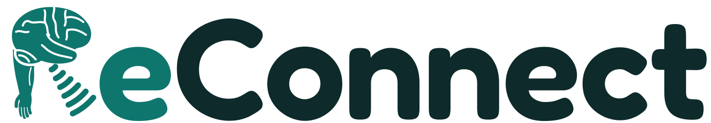

# ReConnect



Home stroke rehab with a provider plan. A therapist assigns a 30-day plan of exercises; the patient opens
ReConnect on a computer, sees **today's goals** at the top, does them (using their phone as a motion controller
or tap pad), and can practise anything else in the library as bonus work. The provider sees what was assigned,
what was done, and what was extra.

**Live site:** https://bhuvankanna.github.io/ReConnect/

Built as a prototype for the Sling Health neuroscience team at UT Austin. Not a medical device.

## Demo mode

This version is one website that contains both sides, so you can try the whole loop on one computer. Switch
with **Demo: Patient | Provider** at the top. Everything is saved in this browser only.

- **Provider:** pick a patient (or add one), set a start date, and build the 30-day plan: choose a day, add
  exercises with their level and reps or time, mark rest days, and **Copy week 1 to all weeks**. Standing
  exercises (17 of them, such as Sit to Stand, Balance Hold, Standing Weight Shift, Mini Squats and Cone Reach) stay
  locked until you turn them on for that patient. The **Progress** tab
  shows days done, extra sessions, a 30-day adherence strip and every session tagged Assigned, Extra or Before plan,
  with **Export CSV** and **Print report**.
- **Patient:** the Today bar shows today's assigned exercises and starts the next one with the provider's settings.
  When they're all done it says so, and anything played after that counts as bonus practice.
- The demo starts with two patients: Bhuvan K. is 11 days into a plan and Basant K. is behind on theirs. Add a
  patient in the provider view to build a plan from scratch.
  **Reset demo data** in the provider sidebar puts them back.

Real provider and patient accounts, a server and remote reports are the next step; the data model (patients,
plans, sessions tagged with `patientId` and `assigned`) is built so that move doesn't mean starting over.

## Use it with a phone

1. Open the site on a computer (Chrome, Edge, Safari or Firefox).
2. Tap the phone button at the top right and scan the QR code. On the phone, tap **Start motion**; on iPhone, tap **Allow**.
3. Pick an exercise and press **Start with phone**. Motion exercises calibrate for 3 seconds first; finger and
   guided exercises turn the phone into a tap pad (a keypad, four finger lanes, or a big Done button).

No phone? Tick **Use the mouse instead of a phone** in the same panel: the pointer stands in for the tilt of the
hand, holding the mouse button stands in for a push, and touch exercises work with the mouse or a touchscreen.

## The 126 exercises

| Section | Exercises |
| --- | --- |
| Arm & shoulder (20) | Lantern Lift, Side Raise, Reach Targets, Cup to Mouth, Push Away, Trace It, Swing the Gate, Paint the Fence, Follow the Moon, Stir the Pot, Pendulum Swing, Fruit Catch, Quick Reach, Reach and Turn, Draw the Sword, Bowling, Press Down, Aim the Spotlight, Tennis Swing, Airplane Arms |
| Wrist & forearm (16) | Pour the Tea, Combination Lock, Tilt Maze, Wrist Bend, Wrist Wiper, Steady Cup, Turn the Key, Raise the Drawbridge, Steering Wheel, Wrist Circles, Water the Plants, Open the Jar, Scoop and Hold, Fill to the Line, Spoon the Soup, Sail the Boat |
| Hand & fingers (22) | Finger Tap, Finger Rhythm, Dial a Number, Pinch & Place, Whack-a-Mole, Piano Scales, Drum Roll, Tap the Beat, Number Hunt, Type the Word, Count the Taps, Peg Board, Shake the Bottle, Pen Grip Drawing; follow-along Grip & Release, Putty Squeeze, Finger Curls, Thumb Touches, Clothespins, Coins, Buttons, Knife & Fork |
| Trunk & legs (38) | Lean & Shift, Trunk Twist, Sit to Stand, Balance Hold, Seated March, Reach to the Floor, Side Reach, Forward and Back, Trunk Circles, Knee Straighten, Knees Apart, Foot Lift, Ankle Trace, Toe Taps, Bridges, Standing Weight Shift, Mini Squats, Lean Forward and Hold, Reach Across, Head Turns, Yes Nods, Gaze Stabilization, Ear to Shoulder, Side Bend Hold, Knee Lift Hold, Penalty Kick, Ankle Circles, Ankle In and Out, Gas Pedal, Seated Cycling, Side-Lying Leg Lift, Knee Rolls, Ski Slalom, Heel-Toe Rock, Sit Up Tall, Toes Up Hold; follow-along Heel Raises, Ankle Pumps |
| Therapy sessions (2) | Mirror Therapy, Mental Practice |
| Visual scanning (3) | Cancel It, Look Left Search, Find the Middle |
| Attention (5) | Quick Catch, Go / No-Go, Night Watch, Two at Once, Trail Connect |
| Memory (7) | Memory Moves, Card Pairs, N-Back, Number Span, Word Recall, Shopping List, Names & Faces |
| Reasoning (8) | Sort It, Tower Puzzle, Errand Planner, What Comes Next, Turn the Shape, Make Change, Tell the Time, Rule Switch |
| Language (5) | Name It, Word to Picture, Word Web, Finish the Sentence, Spell It |

The 169 motion-tracked exercises were cut to 74 in October 2026: each one left is a distinct phone movement
in a distinct phone position, and the rest were the same movement under a different name. In the library, **How you play** filters by Phone motion, Touch or Follow along. Every exercise has three levels and an assignable amount (reps,
rounds or time). **About these exercises** in the
app, and [`docs/exercise-catalog.md`](docs/exercise-catalog.md), list the programs and studies each one comes from.

## What gets measured

- **Every session:** reps or rounds, time, the settings it was played at, and whether it filled an assigned item.
- **Motion:** pitch and roll range from the calibrated rest position, and speed peaks per repetition (a simplified
  version of mRehab's smoothness score). Exercise-specific results such as best lift, sway, taps per second.
- **Brain exercises:** accuracy, reaction or decision time, and task-specific results (missed on the left vs right
  for scanning, longest span, rule changes found, hints used).

## How it works

The whole app is static files, which is why it can run on GitHub Pages.

- `index.html` is the shell; `css/app.css` the theme; `js/` the app, loaded as plain scripts sharing a `window.RC`
  namespace. `js/plan.js` (plan rules) and `js/data.js` (storage and demo seed) are pure and unit-tested in Node.
  Each library section is one file in `js/games/`; shared building blocks (rep counter, tilt cursor, answer cards,
  keypad, guided session) are in `js/kit.js`.
- Five exercises are 3D scenes, built on three.js loaded on demand by `js/scene3d.js`. Each falls back to a flat
  2D view if WebGL isn't available, and steps down on a slow computer (lower resolution and no shadows first,
  then the 2D view if it still runs under about 22 frames a second):
  - **Lantern Lift** (`js/lift3d.js`), first person: the patient's own arm lifts a lantern into a gold ring,
    and each rep lights a lantern in the garden.
  - **Pour the Tea** (`js/pour3d.js`): a teapot over a kitchen table tips with the forearm and pours a real
    stream into a glass cup with a green fill line. Too fast splashes tea onto the table, pouring past the
    line overflows the cup, and full cups slide to a row at the back. A speed meter and turn arrows sit on top.
  - **Trunk Twist** (`js/twist3d.js`, `js/twist-scenes.js`, `js/twist-animals.js`): turning the shoulders looks
    around a full 3D world, picked on the setup screen from nine: Jungle, Dinosaur Valley, Outer Space, Coral
    Reef, Farm, Snowy North, Tropical Island, Blossom Garden and Desert Pyramids. An animal (or rocket, or
    balloon) appears on one side; holding still on it finds it, then the next one appears on the other side.
    Every scene is built from code (no image or model files) with the same seeded shape kit.
  - **Ear to Shoulder** (`js/tilt3d.js`): a balance game on a pier at sunset. The whole picture slowly tips,
    tipping the board so a beach ball starts to roll; tipping the head the other way levels the picture. A
    spirit level at the bottom shows how close to level it is. Hold it level, then it tips the other way.
  - **Steering Wheel** (`js/drive3d.js`), first person from the driver's seat of a little convertible on an
    endless country road (meadow, village, farm, forest, lake). The wheel and the patient's hands turn exactly
    as far as the phone does, and the car moves across the three lanes with the wheel. Each gate has a green
    arch over one lane and barriers in the others; a green marker by the wheel shows where to turn it. Gates
    mostly sit in the outside lanes and swap sides, so reaching one takes a 30° turn at level 1, 42° at
    level 2 and 54° at level 3.
- The computer registers a 6-digit code (`mend-rehab-<code>`) with the free [PeerJS](https://peerjs.com) broker and
  shows it as a QR code. `phone.html` connects by that code and the two talk over a WebRTC data channel.
- If a relay is configured (`js/config.js`, see [`relay/README.md`](relay/README.md)), the computer also registers
  the code with it, and the phone tries it first. The relay is a small Cloudflare Worker that passes the same
  messages over WebSockets, so pairing works across any two networks (mobile data, school or clinic Wi-Fi). If
  the relay can't be reached, the phone falls back to the direct PeerJS link.

Messages are small JSON objects:

- phone → computer: `{type:"m", b, g, a, mag, lin}` (tilt, heading, acceleration), `{type:"tap", key}`, `{type:"hb"}` every 2 s, `{type:"bye"}`, `{type:"recenter"}`
- computer → phone: `{type:"status", …}`, `{type:"pad", layout, labels}`, `{type:"haptic", pattern}`, `{type:"calibrated"}`, `{type:"replaced"}`

The computer treats 6 seconds without a message as a disconnect. A pad exercise then keeps going with on-screen keys.

### Privacy note

Only angles and taps travel between the devices; nothing identifies the person. The PeerJS broker sees the
pairing code; so does the relay, if you use one (it only forwards messages and stores nothing). A real clinical version should run its own broker and TURN server and store data in a
HIPAA-eligible backend.

## Develop and test

```bash
python3 -m http.server 8000            # then open http://localhost:8000
node --test "tests/*.test.js"          # plan, storage and rep-counter unit tests
python3 tests/engines_test.py          # plays every motion-library exercise to the end at all three levels
python3 -m pip install playwright && python3 -m playwright install chromium
python3 tests/smoke_test.py            # end to end: pairing, phone pad, all games, Today flow, provider, every exercise
python3 tests/smoke_test.py --families memory,language   # just some exercise groups
python3 tests/smoke_test.py --site https://<user>.github.io/<repo>/
(cd relay && npm install && npx wrangler dev)                          # local relay on :8787
python3 tests/smoke_test.py --relay http://127.0.0.1:8787 --relay-only  # pair only through the relay
```

The phone page needs https to read motion sensors, so test phone control on the deployed site or through a tunnel.

## Known limits

- **Pairing across networks:** without the relay, the direct link usually only works when the phone and computer
  share a network. Deploy the relay ([`relay/README.md`](relay/README.md)) and set its address in `js/config.js`.
- iPhones don't vibrate from web pages, so haptic feedback works on Android only.
- Pictures in the language exercises use the device's emoji font, so they look different on different systems.
- Nothing here is clinically validated. Talk to the care team before using it with a patient.

## Credits

- [PeerJS](https://github.com/peers/peerjs) 1.5.4, MIT license (`vendor/peerjs.LICENSE`)
- [qrcode-generator](https://github.com/kazuhikoarase/qrcode-generator) 1.4.4 by Kazuhiko Arase, MIT license (header of `vendor/qrcode.js`)
- [three.js](https://threejs.org) r170, MIT license (`vendor/three/LICENSE`), for the 3D exercises
- Font: [Fredoka](https://fonts.google.com/specimen/Fredoka) via Google Fonts, SIL Open Font License (also used for the logo wordmark)

ReConnect's own code is MIT licensed; see `LICENSE`.
